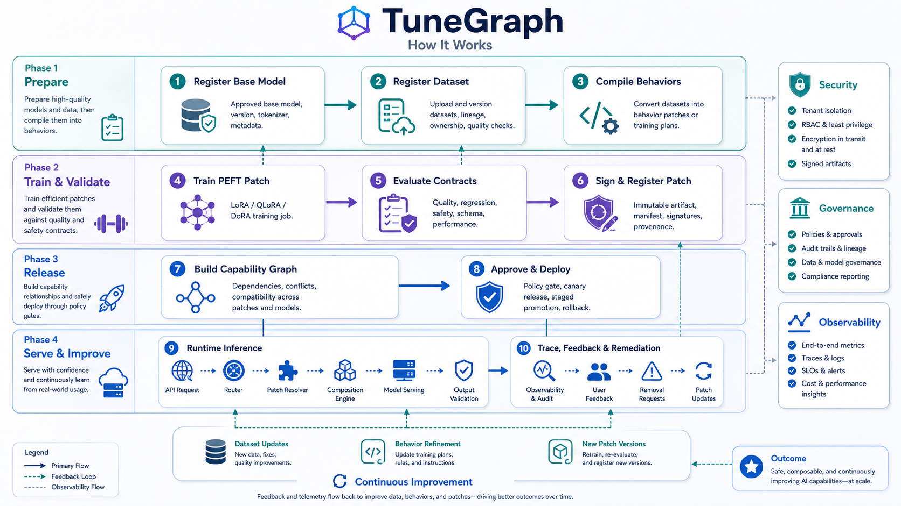
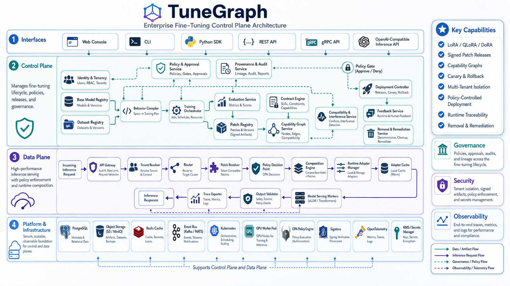

# TuneGraph

**Enterprise control plane for traceable, composable, and reversible PEFT model behavior.**

TuneGraph treats LoRA and other parameter-efficient adaptations as governed software artifacts. Every behavior change has a source, version, contract suite, approval state, deployment record, inference trace, and rollback path.

> Project status: production-oriented alpha. The repository contains a complete runnable control plane, optional PEFT worker, OpenAI-compatible inference gateway, web console, database migrations, Docker and Kubernetes deployment assets, tests, and operating guides. Advanced research capabilities such as exact record-level unlearning and token-level routing remain explicitly experimental.

## Why TuneGraph

A normal LoRA workflow produces an adapter file. TuneGraph produces an auditable **behavior release**:

```text
Approved data
    ↓
Training specification
    ↓
Signed behavior patch
    ↓
Executable contracts
    ↓
Dependency and conflict graph
    ↓
Policy-controlled deployment
    ↓
Request-level patch trace
    ↓
Rollback, revocation, or remediation
```

## Included capabilities

- Organization-scoped multi-tenancy model
- JWT authentication, refresh tokens, API keys, Argon2 password hashing, and RBAC
- Immutable base-model, dataset, capability, training-job, patch, graph, and deployment records
- Dataset validation gates and approval workflow
- LoRA, QLoRA, and DoRA training specification with lazy Hugging Face PEFT integration
- Executable contract suites for metrics, JSON Schema, regex, required fields, and latency
- Patch state machine with approval, canary, production, deprecation, retirement, and revocation
- Patch dependencies, conflicts, cycle detection, base-model compatibility, and graph validation
- Signed patch manifests and graph snapshots with Ed25519
- Optional OPA policy decisions with a built-in default-deny production policy
- OpenAI-compatible `/v1/chat/completions` proxy for vLLM or another compatible backend
- Request-to-graph and request-to-patch inference traces without storing raw prompts by default
- Removal impact analysis and evidence-driven remediation workflow
- Append-only audit event model
- Python SDK and Typer CLI
- Next.js administrative console
- Alembic database migrations
- Docker Compose development environment
- Hardened Docker images and Helm chart
- GitHub Actions, security scans, contribution guidance, and runbooks

## How it works



## Architecture

```text
┌────────────────────────────────────────────────────────────┐
│ Interfaces                                                 │
│ Next.js Console · REST API · OpenAI API · CLI · Python SDK │
└───────────────────────────┬────────────────────────────────┘
                            │
┌───────────────────────────▼────────────────────────────────┐
│ Control plane                                              │
│ Identity · Dataset registry · Training · Contracts         │
│ Patch registry · Capability graph · Policy · Audit         │
│ Deployments · Provenance · Removal impact                  │
└───────────────────────────┬────────────────────────────────┘
                            │ signed graph and patch plans
┌───────────────────────────▼────────────────────────────────┐
│ Data plane                                                 │
│ Authentication · Graph resolution · Policy decision       │
│ Adapter selection · OpenAI-compatible proxy · Tracing      │
└───────────────────────────┬────────────────────────────────┘
                            │
┌───────────────────────────▼────────────────────────────────┐
│ Platform                                                   │
│ PostgreSQL · Object/OCI storage · OPA · vLLM · Kubernetes  │
└────────────────────────────────────────────────────────────┘
```

The control plane is implemented as a modular FastAPI application. Compute-heavy training and latency-sensitive inference are independent processes. This minimizes initial operational complexity while preserving clean service boundaries.



## Repository layout

```text
src/tunegraph/             Python control plane, SDK, CLI, worker, ML integration
console/                   Next.js administrative console
alembic/                   Immutable database migrations
deploy/helm/tunegraph/     Kubernetes Helm chart
deploy/opa/                Default OPA policy
deploy/docker/             GPU worker image
examples/                  Runnable lifecycle examples
docs/                      Architecture, production, security, and operations guides
tests/                     Unit and service tests
.github/workflows/         CI and security workflows
```

## Requirements

For local control-plane development:

- Python 3.11 to 3.13
- PostgreSQL 15 or newer for production. SQLite is supported only for development and tests.
- `uv` or a standard Python virtual environment

For PEFT training:

- Linux
- CUDA-compatible GPU for practical model sizes
- PyTorch, Transformers, PEFT, TRL, Accelerate, Datasets
- BitsAndBytes for the reference QLoRA path

For the console:

- Node.js 24 LTS or newer

## Local quick start

### 1. Create the environment

```bash
cp .env.example .env
python -c "import secrets; print(secrets.token_urlsafe(48))"
# Put the generated value in TUNEGRAPH_SECRET_KEY.

uv sync --extra dev
```

### 2. Generate signing keys

```bash
uv run tunegraph keys generate
```

Add these values to `.env`:

```bash
TUNEGRAPH_SIGNING_PRIVATE_KEY_PATH=./var/keys/tunegraph-private.pem
TUNEGRAPH_SIGNING_PUBLIC_KEY_PATH=./var/keys/tunegraph-public.pem
```

Never commit the private key. Production installations should use a secrets manager or external signing service.

### 3. Apply migrations

```bash
uv run alembic upgrade head
```

### 4. Bootstrap the platform administrator

```bash
uv run tunegraph bootstrap \
  --email admin@example.com \
  --organization "Example AI" \
  --slug example-ai
```

The CLI prompts securely for the initial password.

### 5. Start the API

```bash
uv run uvicorn tunegraph.main:app --host 0.0.0.0 --port 8000 --reload
```

Development API documentation is available at `http://localhost:8000/docs`.

### 6. Sign in

```bash
curl -s http://localhost:8000/api/v1/auth/login \
  -H 'Content-Type: application/json' \
  -d '{
    "organization_slug": "example-ai",
    "email": "admin@example.com",
    "password": "your-password"
  }'
```

Use the returned access token:

```bash
export TG_TOKEN="..."
curl -s http://localhost:8000/api/v1/base-models \
  -H "Authorization: Bearer $TG_TOKEN"
```

## Docker Compose

The default stack starts PostgreSQL, OPA, the API, and the web console:

```bash
export TUNEGRAPH_SECRET_KEY="$(python -c 'import secrets; print(secrets.token_urlsafe(48))')"
docker compose up --build
```

Bootstrap the first administrator:

```bash
docker compose exec api tunegraph bootstrap \
  --email admin@example.com \
  --organization "Example AI" \
  --slug example-ai
```

The optional GPU worker is in the `ml` profile:

```bash
docker compose --profile ml up --build
```

The inference backend is intentionally external. Configure `TUNEGRAPH_INFERENCE_BACKEND_URL` to an OpenAI-compatible vLLM deployment.

## Complete lifecycle example

The following sequence describes the intended workflow.

### Register and approve a base model

```json
POST /api/v1/base-models
{
  "name": "qwen-support-7b",
  "provider": "internal-registry",
  "source_uri": "oci://registry.example/models/qwen-support-7b",
  "revision": "sha256:immutable-revision",
  "architecture": "decoder-only-transformer",
  "tokenizer_revision": "sha256:tokenizer-revision",
  "license_id": "approved-internal-license",
  "manifest_sha256": "aaaaaaaaaaaaaaaaaaaaaaaaaaaaaaaaaaaaaaaaaaaaaaaaaaaaaaaaaaaaaaaa",
  "metadata_json": {"supported_precisions": ["bf16", "int4"]}
}
```

Then call `POST /api/v1/base-models/{id}/approve`.

### Register, validate, and approve a dataset

```json
POST /api/v1/datasets
{
  "name": "refund-examples",
  "version": 1,
  "owner": "support-ai-team",
  "source_uri": "s3://example-ai-datasets/refunds/v1/train.jsonl",
  "content_sha256": "bbbbbbbbbbbbbbbbbbbbbbbbbbbbbbbbbbbbbbbbbbbbbbbbbbbbbbbbbbbbbbbb",
  "record_count": 3240,
  "purpose": ["supervised-fine-tuning"],
  "classification": "confidential",
  "contains_personal_data": false,
  "retention_days": 365,
  "metadata_json": {"label_conflict_rate": 0.01}
}
```

Run validation and approval:

```text
POST /api/v1/datasets/{id}/validate
POST /api/v1/datasets/{id}/approve
```

### Define a capability

```json
POST /api/v1/capabilities
{
  "key": "customer-support.refunds",
  "name": "Refund decisions",
  "description": "Apply approved refund classification and response behavior."
}
```

### Queue a training job

```json
POST /api/v1/training-jobs
{
  "name": "refund-policy-v1",
  "base_model_id": "...",
  "dataset_id": "...",
  "capability_id": "...",
  "method": "qlora",
  "specification": {
    "model_name_or_path": "Qwen/example-model",
    "dataset_uri": "/datasets/refunds.jsonl",
    "output_dir": "/artifacts/refund-policy-v1",
    "text_field": "text",
    "epochs": 3,
    "method": {
      "type": "qlora",
      "rank": 16,
      "alpha": 32,
      "target_modules": ["q_proj", "k_proj", "v_proj", "o_proj"]
    }
  }
}
```

The reference worker polls queued jobs. Larger installations should replace polling with a Kafka, NATS, Ray, Slurm, or cloud-training adapter while preserving the same job state machine.

### Create contracts

```json
POST /api/v1/contract-suites
{
  "name": "refund-production",
  "version": 1,
  "gates": [
    {
      "id": "refund-f1",
      "evaluator": "metric_threshold",
      "metric": "macro_f1",
      "operator": ">=",
      "threshold": 0.94,
      "blocking": true
    },
    {
      "id": "response-schema",
      "evaluator": "json_schema",
      "blocking": true,
      "config": {
        "schema": {
          "type": "object",
          "required": ["eligible", "reason"],
          "properties": {
            "eligible": {"type": "boolean"},
            "reason": {"type": "string"}
          }
        }
      }
    }
  ]
}
```

### Register and promote a signed patch

A patch manifest contains the base model, capability, immutable artifact digest, training job, and contract suite. Production installations reject unsigned manifests.

State transitions are explicit:

```text
draft → training → evaluation_pending → candidate → review_pending
      → approved → staged → canary → production → deprecated → retired
```

Revocation is terminal and may occur from any active stage.

### Build a graph

```json
POST /api/v1/graphs
{
  "name": "support-india",
  "version": 1,
  "base_model_id": "...",
  "patch_ids": ["..."],
  "router_config": {"mode": "explicit", "max_active_patches": 4},
  "policy_revision": "support-policy-v1"
}
```

TuneGraph resolves required dependencies, rejects blocking conflicts, checks deployable states, detects cycles, and verifies that every patch targets the same base-model revision.

### Deploy and invoke

```json
POST /api/v1/deployments
{
  "name": "support-agent",
  "environment": "production",
  "graph_release_id": "...",
  "traffic_percentage": 0,
  "configuration": {"region": "ap-south-1"}
}
```

Use canary and promotion endpoints before routing all traffic.

```json
POST /v1/chat/completions
{
  "model": "support-agent",
  "messages": [{"role": "user", "content": "My package never arrived."}],
  "tunegraph": {
    "deployment": "support-agent",
    "capabilities": ["customer-support.refunds"],
    "trace_level": "standard"
  }
}
```

The response contains TuneGraph metadata with the graph release, patch IDs, policy decision, and request ID.

## Serving and adapter composition

vLLM supports request-level LoRA selection by model name. The reference gateway routes a single patch directly. Multi-patch graphs are traced and governed, but production serving should use one of these strategies:

1. Pre-approved merged or distilled composition registered as one adapter.
2. A serving backend that supports the selected multi-adapter composition algorithm.
3. A custom TuneGraph data-plane plugin.

TuneGraph never pretends that arbitrary adapter addition is safe. Every composition requires its own contracts and compatibility evidence.

## Training worker

Install the ML dependencies:

```bash
uv sync --extra ml
```

Start the worker:

```bash
tunegraph-worker
```

The reference trainer:

- Lazily imports heavy dependencies
- Disables remote model code
- Supports local JSON, JSONL, Parquet, and Hugging Face dataset identifiers
- Produces PEFT adapter artifacts and a content-hashed TuneGraph manifest
- Overrides user-provided output paths with a controlled artifact-root location
- Keeps the base model frozen
- Supports LoRA, QLoRA, and DoRA configurations

For large-scale use, run the worker in a dedicated GPU namespace with workload identity, restricted egress, read-only model inputs, and separate artifact credentials.

## Web console

```bash
cd console
npm install
TUNEGRAPH_API_URL=http://localhost:8000 npm run dev
```

The console provides inventory views for patches, graph releases, and deployments. Authentication tokens are stored in HTTP-only cookies. The management API remains the authoritative interface.

## Production deployment

Read [`docs/production.md`](docs/production.md) before deployment. Minimum production requirements:

- PostgreSQL with backups and point-in-time recovery
- Long random application secret in a secrets manager
- Ed25519 signing keys mounted from a secrets manager
- TLS at every external boundary
- SSO or tightly controlled bootstrap credentials
- OPA policies with default deny
- Immutable model and adapter revisions
- Private artifact registry or object storage
- Separate GPU worker identities
- Network policies and restricted egress
- Centralized OpenTelemetry, logs, metrics, and alerts
- Tested graph rollback and patch revocation runbooks
- Human approval for medium and high-risk releases

Install the Helm chart:

```bash
helm upgrade --install tunegraph deploy/helm/tunegraph \
  --namespace tunegraph \
  --create-namespace \
  --values my-production-values.yaml
```

The chart deliberately expects externally managed PostgreSQL, OPA, vLLM, and Kubernetes secrets.

## Security model

TuneGraph implements defense in depth:

- Passwords are hashed with Argon2id.
- API keys are displayed once and stored only as SHA-256 digests.
- Access and refresh tokens have distinct token types.
- Authorization is organization-scoped and permission-based.
- Production configuration rejects SQLite, development secrets, unsigned artifacts, and missing signing keys.
- Patch and graph manifests use canonical JSON and Ed25519 signatures.
- Artifact paths are content-addressed and constrained to the configured root.
- Policy decisions occur after candidate routing and before inference.
- Revoked patches are rejected even when cached by a serving backend.
- Raw prompt and response storage is disabled by design. Only digests and operational metadata are persisted by the reference gateway.
- Docker and Kubernetes defaults use non-root users, dropped Linux capabilities, read-only filesystems, and network policies.

See [`SECURITY.md`](SECURITY.md), [`docs/threat-model.md`](docs/threat-model.md), and [`docs/security-deployment.md`](docs/security-deployment.md).

## Removal and unlearning

TuneGraph provides lineage-based impact analysis:

```text
Source or dataset
  → training jobs
  → patch releases
  → graph releases
  → deployments
```

It then creates a remediation plan for containment, localized retraining, retain-set testing, forget-set testing, graph replacement, and evidence capture.

TuneGraph does **not** claim that graph exclusion or adapter removal proves complete neural erasure. Exact unlearning is an open research problem. Any erasure claim must be supported by the selected method and independent evidence.

## Configuration

All settings use the `TUNEGRAPH_` prefix. Important variables:

| Variable | Purpose |
|---|---|
| `TUNEGRAPH_ENVIRONMENT` | `development`, `test`, `staging`, or `production` |
| `TUNEGRAPH_DATABASE_URL` | SQLAlchemy async database URL |
| `TUNEGRAPH_SECRET_KEY` | JWT signing secret, minimum 32 characters |
| `TUNEGRAPH_ARTIFACT_ROOT` | Local content-addressed artifact root |
| `TUNEGRAPH_INFERENCE_BACKEND_URL` | OpenAI-compatible inference backend |
| `TUNEGRAPH_OPA_URL` | OPA base URL. Empty uses built-in policy. |
| `TUNEGRAPH_SIGNING_PRIVATE_KEY_PATH` | Ed25519 private signing key |
| `TUNEGRAPH_SIGNING_PUBLIC_KEY_PATH` | Ed25519 verification key |
| `TUNEGRAPH_TRUSTED_HOSTS` | JSON array for host validation |
| `TUNEGRAPH_CORS_ORIGINS` | JSON array of allowed console origins |

Run `tunegraph doctor` for a secret-safe configuration summary.

## Testing

```bash
uv sync --extra dev
uv run pytest --cov=tunegraph
uv run ruff check .
make typecheck
```

Before releasing a production image, also run:

- Alembic upgrade and downgrade tests against PostgreSQL
- Docker image scanning
- SBOM generation
- API fuzzing
- Tenant-isolation tests
- Prompt-injection and poisoning tests
- Canary and rollback drills
- Load tests with representative adapters and GPU hardware

## API stability

Version `0.x` is an alpha line. Database migrations are forward compatible within documented releases, but management API fields may evolve. Stable versioned APIs begin at `/api/v1`.

## Contributing

Read [`CONTRIBUTING.md`](CONTRIBUTING.md). Major algorithm, schema, or lifecycle changes require an RFC under `rfcs/`.

## License

Apache License 2.0. Third-party models, datasets, adapters, and generated artifacts retain their own licenses and usage restrictions.
